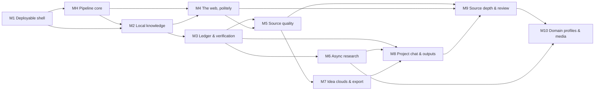

# Searchy Implementation Plan

This is the tracker for building Searchy. It breaks [`SearchyDesign.md`](../SearchyDesign.md) into 47 features across 10 milestones, plus 14 pipeline-core features (H1–H14). Each feature has its own document, sized for one Claude Code session.

The H-series builds the full stage pipeline: stages, classifiers, counselors, turn-end validation and the tracer. The design for it is adapted from [`appendix/HarnessDesign.md`](../appendix/HarnessDesign.md). Searchy keeps that design's Rust core and TOML profiles. It replaces the Ratatui TUI with web pages, for example a trace viewer in the browser. The H-series uses its own numbers so that F1–F47 keep the numbers in the design doc.

**How to use this file**

1. Pick a feature from **Next up**. All of its dependencies are done.
2. Open its feature doc, build it, and check off the acceptance criteria in that doc.
3. Update its row below: set the status, add the date, and note anything that changed.
4. Recompute **Next up**: any feature whose dependencies are all ✅ is ready to start.

The machines and model servers this deployment targets are recorded in `ENVIRONMENT.md`. It's gitignored because it describes a private network; copy [`ENVIRONMENT.example.md`](ENVIRONMENT.example.md) to create it. Use it when testing the installer, model routing, embeddings and search.

If a decision made during implementation changes the design, update `SearchyDesign.md` too. Otherwise the feature docs and the design doc will drift apart.

**Status legend:** ⬜ Not started · 🟨 In progress · ✅ Done · ⏸️ Blocked · ✂️ Cut/deferred

---

## Next up

| Feature | Why it's ready |
| --- | --- |
| [F1 Cargo workspace and role binary](m01-deployable-shell/f01-cargo-workspace.md) | No dependencies |

After F1, these become ready: F2 (container image), F4 (auth), F5 (projects data model) and H1 (pipeline core types). After H1: H2 (provider adapters) and H6 (stage runner). M1 and the early H features can then proceed in parallel. F8 (model routing) waits on F5, H2 and H12.

---

## Milestone map

The tool can be deployed and used from a phone after **M1**. It is useful for real research after **M3**.

**MH** (pipeline core) needs only F1 to start, plus F5 and F7 for its storage and streaming pieces. Most of it can be built alongside M1. H1–H11 must be done before F12 (quick depth). H12 must be done before F8, and H13–H14 before F31 (project chat).

- **M8** (project chat) can start right after M3 (F31). Its handoff, cluster, and dataset features wait on M6 and M7.
- **M4** needs F6 and H8 for the Fetcher and its politeness counselors. Only F19 (SearXNG) waits on M2 (F12), so most of M4 can run in parallel with M2 and M3.
- **M9** needs M5 and the web fetcher. **M10** builds on M9.

---

## Progress

| Milestone | Features | Done |
| --- | --- | --- |
| M1 Deployable shell | 7 | 0 |
| MH Pipeline core | 14 | 0 |
| M2 Local knowledge | 5 | 0 |
| M3 Ledger and verification | 4 | 0 |
| M4 The web, politely | 4 | 0 |
| M5 Source quality | 3 | 0 |
| M6 Async research | 4 | 0 |
| M7 Idea clouds and export | 3 | 0 |
| M8 Project chat and outputs | 5 | 0 |
| M9 Source depth and adversarial review | 5 | 0 |
| M10 Domain profiles and media | 7 | 0 |
| **Total** | **61** | **0** |

---

## Feature tracker

### M1 — Deployable shell

| # | Feature | Depends on | Status | Done on | Notes |
| --- | --- | --- | --- | --- | --- |
| F1 | [Cargo workspace and role binary](m01-deployable-shell/f01-cargo-workspace.md) | — | ⬜ | | Pipeline crate itself is H1 |
| F2 | [Container image and multi-arch CI](m01-deployable-shell/f02-container-image.md) | F1 | ⬜ | | |
| F3 | [Installer, Quadlets and compose file](m01-deployable-shell/f03-installer-quadlets.md) | F2 | ⬜ | | |
| F4 | [Accounts and auth](m01-deployable-shell/f04-accounts-auth.md) | F1 | ⬜ | | |
| F5 | [Projects, questions, runs and project roles](m01-deployable-shell/f05-projects-data-model.md) | F1 | ⬜ | | |
| F6 | [Job queue, Runner trait and launcher sidecar](m01-deployable-shell/f06-job-queue-launcher.md) | F5 | ⬜ | | |
| F7 | [SSE progress, Inbox, Web Push and PWA](m01-deployable-shell/f07-progress-notifications.md) | F6 | ⬜ | | |

### MH — Pipeline core

Adapted from [`HarnessDesign.md`](../appendix/HarnessDesign.md). The "From harness" column names the harness features each one covers.

| # | Feature | Depends on | From harness | Status | Done on | Notes |
| --- | --- | --- | --- | --- | --- | --- |
| H1 | [Pipeline crate and core types](mh-pipeline-core/h01-pipeline-core-types.md) | F1 | F1 | ⬜ | | |
| H2 | [Provider adapters and streaming](mh-pipeline-core/h02-provider-adapters.md) | H1 | F2, F8 | ⬜ | | |
| H3 | [Turn store, tracer and web trace viewer](mh-pipeline-core/h03-turn-store-tracer.md) | H1, F5 | F3, F6 | ⬜ | | |
| H4 | [Context assembler and prompt caching](mh-pipeline-core/h04-context-assembler.md) | H2, H3 | F4, F20 | ⬜ | | |
| H5 | [Tool registry, tool loop and parallel calls](mh-pipeline-core/h05-tool-loop.md) | H2, H3 | F7, F22 | ⬜ | | |
| H6 | [Stage runner, profile validation and rules classifiers](mh-pipeline-core/h06-stage-runner-classifiers.md) | H1 | F9, F10 | ⬜ | | |
| H7 | [Input stages](mh-pipeline-core/h07-input-stages.md) | H6 | F11 | ⬜ | | |
| H8 | [Counselor hooks and starter counselors](mh-pipeline-core/h08-counselors.md) | H5, H6 | F12 | ⬜ | | |
| H9 | [Turn-end validation, retry loop and streaming modes](mh-pipeline-core/h09-turn-end-validation.md) | H5, H6, F7 | F13, F16 | ⬜ | | |
| H10 | [Judge helper and judge classifiers](mh-pipeline-core/h10-judges.md) | H2, H8, H9 | F15 | ⬜ | | |
| H11 | [Calculator tool and computed-answer check](mh-pipeline-core/h11-calculator-cross-check.md) | H5, H7, H8, H9 | F17, F18 | ⬜ | | The worked example; F15 builds on it |
| H12 | [Error recovery and reasoning management](mh-pipeline-core/h12-error-recovery-reasoning.md) | H2, H4 | F23, F25 | ⬜ | | |
| H13 | [Context compaction and progressive tool disclosure](mh-pipeline-core/h13-compaction-tool-disclosure.md) | H4, H5 | F19, F24 | ⬜ | | |
| H14 | [Interruption, branching and profile replay](mh-pipeline-core/h14-interruption-branching-replay.md) | H9, F7 | F16, F21, F26 | ⬜ | | |

### M2 — Local knowledge

| # | Feature | Depends on | Status | Done on | Notes |
| --- | --- | --- | --- | --- | --- |
| F8 | [Model registry and role routing](m02-local-knowledge/f08-model-routing.md) | F5, H2, H12 | ⬜ | | |
| F9 | [Passage store and hybrid retrieval](m02-local-knowledge/f09-passage-store.md) | F8 | ⬜ | | |
| F10 | [Kiwix container and corpus manager](m02-local-knowledge/f10-kiwix-corpus-manager.md) | F6, F7, F9 | ⬜ | | |
| F11 | [Notes and PDF ingestion](m02-local-knowledge/f11-notes-ingestion.md) | F9 | ⬜ | | |
| F12 | [Quick depth end to end](m02-local-knowledge/f12-quick-depth-e2e.md) | F9, F10, F11, H4, H7–H10 | ⬜ | | |

### M3 — Ledger and verification

| # | Feature | Depends on | Status | Done on | Notes |
| --- | --- | --- | --- | --- | --- |
| F13 | [Claim extraction and claim ledger](m03-ledger-verification/f13-claim-ledger.md) | F12 | ⬜ | | |
| F14 | [Verification stage](m03-ledger-verification/f14-verification-stage.md) | F13, H9, H10 | ⬜ | | |
| F15 | [Number cross-check](m03-ledger-verification/f15-number-cross-check.md) | F14, H11 | ⬜ | | |
| F16 | [Report page with tappable citations](m03-ledger-verification/f16-report-page.md) | F14 | ⬜ | | |

### M4 — The web, politely

| # | Feature | Depends on | Status | Done on | Notes |
| --- | --- | --- | --- | --- | --- |
| F17 | [Fetch proxy worker](m04-polite-web/f17-fetch-proxy.md) | F6, H8 | ⬜ | | |
| F18 | [WARC archiving and archive viewer](m04-polite-web/f18-warc-archive.md) | F17 | ⬜ | | |
| F19 | [SearXNG integration](m04-polite-web/f19-searxng.md) | F12, F17 | ⬜ | | |
| F20 | [Prompt-injection counselor](m04-polite-web/f20-injection-counselor.md) | F17, H8, H10 | ⬜ | | |

### M5 — Source quality

| # | Feature | Depends on | Status | Done on | Notes |
| --- | --- | --- | --- | --- | --- |
| F21 | [Source-type classifier and domain trust list](m05-source-quality/f21-source-classifier-trust.md) | F17, H8 | ⬜ | | |
| F22 | [Crossref retractions and OpenAlex metadata](m05-source-quality/f22-crossref-openalex.md) | F21 | ⬜ | | |
| F23 | [Claim confidence and independence detection](m05-source-quality/f23-claim-confidence.md) | F13, F21 | ⬜ | | |

### M6 — Async research

| # | Feature | Depends on | Status | Done on | Notes |
| --- | --- | --- | --- | --- | --- |
| F24 | [Planner and plan checkpoint](m06-async-research/f24-planner-checkpoint.md) | F7, F12, H12, H13 | ⬜ | | |
| F25 | [Sub-question fan-out and budget counselor](m06-async-research/f25-fan-out-budget.md) | F24, H8, H12 | ⬜ | | |
| F26 | [Datasets and the Analyst worker](m06-async-research/f26-datasets-analyst.md) | F6, F8, F12 | ⬜ | | |
| F27 | [Watches](m06-async-research/f27-watches.md) | F24 | ⬜ | | |

### M7 — Idea clouds and export

| # | Feature | Depends on | Status | Done on | Notes |
| --- | --- | --- | --- | --- | --- |
| F28 | [Claim graph edges and clustering](m07-idea-clouds-export/f28-claim-graph-clustering.md) | F23, F24 | ⬜ | | |
| F29 | [Idea map UI](m07-idea-clouds-export/f29-idea-map-ui.md) | F28 | ⬜ | | |
| F30 | [Export, Zotero and backup role](m07-idea-clouds-export/f30-export-backup.md) | F16 | ⬜ | | |

### M8 — Project chat and outputs

| # | Feature | Depends on | Status | Done on | Notes |
| --- | --- | --- | --- | --- | --- |
| F31 | [Project chat loop](m08-project-chat/f31-project-chat-loop.md) | F14, H13, H14 | ⬜ | | Can start right after M3 |
| F32 | [Answerability classifier and research handoff](m08-project-chat/f32-answerability-handoff.md) | F24, F31 | ⬜ | | |
| F33 | [Scoped chat and idea-map tools](m08-project-chat/f33-scoped-chat.md) | F28, F31 | ⬜ | | |
| F34 | [Outputs: charts, tables, summaries, timelines](m08-project-chat/f34-outputs.md) | F26, F28, F31 | ⬜ | | |
| F35 | [Output staleness and derived notes](m08-project-chat/f35-output-staleness-derived.md) | F23, F34 | ⬜ | | |

### M9 — Source depth and adversarial review

| # | Feature | Depends on | Status | Done on | Notes |
| --- | --- | --- | --- | --- | --- |
| F36 | [Provenance tiers and citation chasing](m09-review/f36-provenance-tiers.md) | F13, F17, F21 | ⬜ | | |
| F37 | [Reliability judges and calibrated confidence labels](m09-review/f37-reliability-judges-labels.md) | F23, F26, F36 | ⬜ | | |
| F38 | [Review job and reviewer checklist](m09-review/f38-review-job.md) | F14, F17, F22 | ⬜ | | |
| F39 | [Debate mode](m09-review/f39-debate-mode.md) | F38 | ⬜ | | |
| F40 | [Verdict card and accept flow](m09-review/f40-verdict-card.md) | F27, F28, F35, F38 | ⬜ | | |

### M10 — Domain profiles and media

| # | Feature | Depends on | Status | Done on | Notes |
| --- | --- | --- | --- | --- | --- |
| F41 | [Profile system](m10-profiles-media/f41-profile-system.md) | F24 | ⬜ | | |
| F42 | [Profile auto-selection](m10-profiles-media/f42-profile-auto-selection.md) | F25, F41 | ⬜ | | |
| F43 | [Science base and health overlay](m10-profiles-media/f43-science-health.md) | F37, F41 | ⬜ | | |
| F44 | [Products profile](m10-profiles-media/f44-products-profile.md) | F37, F41, F45 | ⬜ | | |
| F45 | [Video transcript ingestion](m10-profiles-media/f45-video-transcripts.md) | F11, F17 | ⬜ | | Could move earlier; deps are light |
| F46 | [Saturation stopping and "claims circulating online"](m10-profiles-media/f46-saturation-stopping.md) | F25, F43 | ⬜ | | |
| F47 | [Remaining built-in profiles](m10-profiles-media/f47-remaining-profiles.md) | F26, F41 | ⬜ | | |

---

## Open questions

None right now. Add new ones here as they come up.

## Decisions

Decided on 2026-11-02. The feature docs and `SearchyDesign.md` have been updated to match.

| # | Question | Decision | Affects |
| --- | --- | --- | --- |
| D1 | Chat harness crates | Searchy builds the full pipeline itself, as H1–H14, adapted from `HarnessDesign.md`. The Ratatui TUI is replaced with web pages. | All H docs, F1 |
| D2 | Name check | "Searchy" stays for now. | — |
| D3 | HTTPS | HTTPS is optional. On plain HTTP the hub uses password login and ntfy notifications. Passkeys, Web Push and PWA install turn on automatically when the hub is served over HTTPS, for example with `tailscale serve`. Browsers allow these features only in a secure context, and `http://<lan-ip>` doesn't count. | F3, F4, F7 |
| D4 | How offline workers reach models | Use a **model gateway** in the hub. Workers join an internal Podman network (`--internal`, so no internet route), where they can reach only the gateway. The gateway reaches LAN and localhost models and the cloud APIs. It holds the API keys, enforces local-only routing, and records cost per role. | F6, F8, H2, F11, F13 |
| D5 | Hub-to-Fetcher transport | The Fetcher is a queued per-job worker, started through the launcher like the other worker roles. | F6, F17 |
| D6 | Personal notes | Folder mounts are dropped. Each user uploads documents in the Library, and they are indexed into the database store. Documents are private by default and can be shared to a project. Re-uploading a document replaces and re-indexes it. | F3, F5, F11, F12 |
| D7 | Reliability score | Reliability signals are stored per source, per project. Signal weights are a domain-profile setting. Until profiles exist (F41), the weights are General defaults. | F21, F22, F23, F37, F41 |
| D8 | Turn records | Drop the harness `Session` record. Each turn belongs to a run step or a chat thread. | H1, H3, F31 |
| D9 | Questions during unattended runs | A counselor's `AskUser` becomes an Inbox item. The run step that asked pauses until you answer, and other branches keep going. | H8, F7, F24 |
| D10 | Retry granularity | Turn-end retries target only the failing sentences, not the whole draft. | H9, F14 |
| D11 | Chat and research context | Project chat is part of ongoing research. Chat threads are compacted, and their important points are kept as a running summary that is injected into the planner and research agents' context. Research steps otherwise start from a fresh context. | H13, F24, F31, F32 |
| D12 | Script hooks | Cut. Custom checks are built-in Rust stages or prompt-defined judges in TOML. A hub that runs arbitrary commands from config would also undo the isolation design. | H6, H10 |

## Applied dependency fixes

The feature docs found dependencies that the design's table leaves out. These were applied to the tracker and the feature docs on 2026-11-02.

| Feature | Change | Reason |
| --- | --- | --- |
| F10 | F7 | Download progress shows in the Inbox |
| F19 | F12 | "Standard depth pulls web sources" needs a question pipeline; the real standard depth is F24 |
| F26 | F12 | "Question about your CSV answered" needs a question pipeline |
| F28 | F24 | The gap view uses plan sub-questions |
| F34 | F28 | Contradiction digests are built from contradicts edges |
| F37 | F26 | Dataset ingestion checks need datasets |
| F41 | Dropped F9 | Nothing in the profile system obviously needs the passage store |
| F42 | F25 | Each sub-question gets its own profile only once sub-questions fan out |
| F44 | F45 | Video is a preferred source for products |
| F47 | F26 | Technical docs test claims in the Analyst worker |
| F17, F21 | H8 | The politeness and source-quality gates are counselors |
| F24, F25 | H12 | Depth presets set reasoning budgets |
| H6 | Dropped H3 | H6 needs only a tracer; it uses an in-memory tracer until H3 lands |

**Interim behavior:** several features ship a simpler version first, and a later feature completes it.
- F12's quick answers are unverified until F14.
- F23 can only show corroboration counts until provenance tiers (F36) and labels (F37) exist.
- F25's "thorough" run lacks saturation stopping (F46), citation chasing (F36) and video (F45).
- F38 ships its own `general` reviewer checklist loader; F41 takes it over.
- F41 migrates every hard-coded default into the General profile TOML.

**Possible splits:**
- F47 covers five profiles; one session per profile is more realistic.
- The Climate and Software overlays aren't owned by any feature. Add them to F47, or give each its own feature.

## Undefined values and terms

Each feature doc proposes a default. These are the places where the design is silent:
- Sizes for the quick, standard and thorough budget caps.
- The number of sources per sub-question at standard depth.
- The definition of a "load-bearing" claim.
- How "key sources" are picked for status-check watches.
- The verifier's "uncertain" signal that triggers escalation to a larger model.
- How many rounds a debate runs.
- Whether the debate judge uses the judge role or the reviewer role.
- The size of the "heavy discount" for sponsored opinions.
- How strictly health certainty follows GRADE.
- Whether chat's `start_research` needs approval at quick depth, where the plan checkpoint is off.
- How the launcher's digest-pinned images pick up updates from `podman auto-update`.
- The trust tier for imported BibTeX and Zotero entries.
- Whether Vega-Lite specs may transform data themselves. That would break "numbers are read by the harness."
- Where the PubMed baseline and PMC corpora are downloaded. F43 needs them, but no feature does it.
- The tolerance for comparing numbers in H11 and F15. The calculator expects exact matches, but cited passages often round.

## Design items with no feature yet

These are in the design doc but aren't explicitly covered by any of F1–F47. Each needs a decision: fold it into an existing feature, add a new one, or cut it.

| Item | Design section | Suggested home |
| --- | --- | --- |
| Comments on claims, passages and reports, with @mention notifications | Teams and permissions | New feature after F16 (needs F7 for notifications) |
| Project activity feed UI (the data is recorded in F5) | Teams and permissions | F5 or a small new feature |
| Fair scheduling across users in the job queue | Teams and permissions | F6 |
| Budget caps at instance, user and project level, with "ask first" | Teams and permissions | F25 |
| Bookmarklet or share-sheet target for saving web pages | Knowledge store | New feature after F18 |
| OCR for scanned PDFs | Knowledge store | F11, or a follow-up |
| Other local corpora: Wikidata, arXiv, OpenAlex snapshot, Stack Exchange, Gutenberg | Being a good netizen | Follow-ups to F10, one per corpus |
| First-run setup wizard (admin, models, corpora, notes, SearXNG) | Deployment | Split across F4, F8, F10, F19; a final wizard pass could be its own feature |
| Settings screen | Web interface | Built up incrementally by F8, F10, F19, F21 |
| Depth-preset knobs (the full Quick/Standard/Thorough table) | Research pipeline | F12 (quick), F24/F25 (standard, thorough); F46 finishes thorough |
| Cloudflare Tunnel or reverse-proxy docs | Remote access and auth | Docs task alongside F3 |
| Cancel button for a run on the Run page (H14 provides the mechanism) | Web interface | F25 or F7 |

## Change log

| Date | Change |
| --- | --- |
| 2026-11-02 | Plan created from `SearchyDesign.md`: 47 features in 10 milestones |
| 2026-11-02 | Added the MH milestone (H1–H14), adapted from `appendix/HarnessDesign.md`; added H dependencies to F8, F12, F14, F15, F20, F25 and F31 |
| 2026-11-02 | Recorded decisions D2–D11; proposed cutting script hooks |
| 2026-11-02 | Cut script hooks (D12); applied the dependency fixes; renamed `apendix/` to `appendix/` |
| 2026-11-02 | Added `ENVIRONMENT.example.md`, a template for the gitignored, deployment-specific `ENVIRONMENT.md` |
